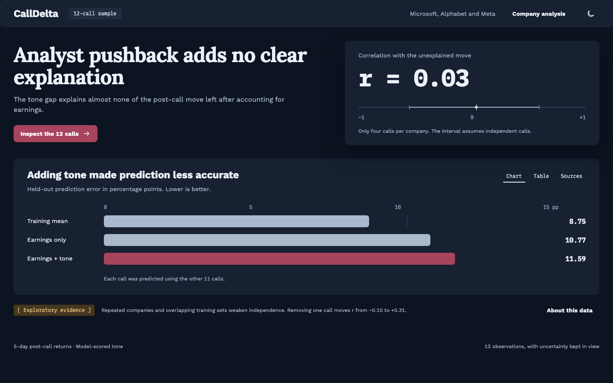
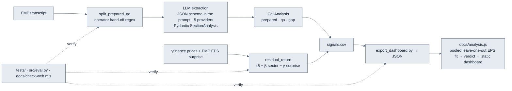

# CallDelta

**How rosy management sounds vs. how sceptical analysts are, scored separately for every earnings call.**

An earnings call has two halves: what management chose to say, and what analysts made them answer. CallDelta scores each half separately with a fixed extraction schema, tags notable passages (*confident, hedging, evasion, admission, contradiction*), tracks the *gap* between the halves across quarters, and sets that gap next to the price move after the call.

**[Open the dashboard](https://nickkklian.github.io/Earnings-Call-Sentiment-Analyser/)**: twelve real calls from Microsoft, Alphabet and Meta, scored from the transcripts each company publishes on its own investor-relations site. A static page: no server, no key.



Choose Claude, OpenAI, Gemini or an OpenAI-compatible server as the model; every reply is validated into the same schema. What the twelve calls show, and why twelve cannot show whether tone predicts returns: [What twelve calls show](#what-twelve-calls-show).

## Try it

```bash
git clone https://github.com/NickkkLian/Earnings-Call-Sentiment-Analyser && cd Earnings-Call-Sentiment-Analyser
python3 -m http.server --directory docs 8000     # then open http://localhost:8000 (no install, no key)
```

**In the browser** — open the [dashboard](https://nickkklian.github.io/Earnings-Call-Sentiment-Analyser/) (static, no server) or serve `docs/` from a clone as above. It opens on the pooled evidence from the twelve real calls, with a link to each call's transcript page. **Inspect the 12 calls** opens the source register. **Company analysis** opens the full company view, including tone trajectories, topic shares, extracts, residual checks and the JSON loader; company links such as `#MSFT` open that company's analysis. **Load JSON** (or drag a file onto the page) replaces the calls with your own pipeline output, validated for shape first; **Sample JSON** (under the schema in the Methodology section) downloads a **synthetic** example file (fictional companies, invented numbers) so you can see the schema.

**What the real data contains.** Scores for the prepared remarks and for the analyst Q&A, topics, EPS surprise and the 5-day returns (EPS estimates and prices from Yahoo Finance via yfinance). Quotes come only from the prepared remarks of each company's latest call: at most 25 words each, checked word for word against the transcript, a passage with an elision or a mid-sentence fragment dropped. Analyst questions are scored but never quoted, and no analyst is named. Two companies carry a caveat on the page, taken from what they said on the calls: Alphabet's EPS in Q3 2025, Q1 2026 and Q2 2026 includes unrealized gains on equity securities, and Meta's includes a one-time tax charge (Q3 2025) and a tax benefit (Q1 2026). Fitting the coefficient does not repair those EPS inputs. The page marks control dominance using the fitted coefficients.

**Re-run it** — `data/ir-calls.json` lists each call's transcript URL and the SHA-256 of the file that was scored (Word files are read with the standard library, PDFs with `pdfminer.six`, MIT-licensed):

```bash
python -m src.ir_run --max-usd 3   # needs ANTHROPIC_API_KEY; stops before the estimated spend passes the cap
```

Scoring the twelve calls took 24 requests on 2026-09-25: about 256,000 input and 26,000 output tokens, roughly US$0.78 at US$2 / US$10 per million (20 requests in the final run, plus 4 for the two July PDF calls after the PDF reader changed to `pdfminer.six`).

**Run the pipeline** — Python 3.10+; keys go in `.env`, never in the repo.

```bash
pip install -r requirements.txt
cp .env.example .env   # then fill in FMP_API_KEY and the key for your model provider
```

```bash
python -m src.cli --tickers NWSC,HRBS --quarters 2025Q1,2025Q2 --provider anthropic --out signals.csv
python -m src.export_dashboard signals.csv -o dashboard_data.json
```

Replace the fictional tickers with real ones FMP has transcripts for (most US-listed large and mid caps). Then open the dashboard and load `dashboard_data.json`.

## What is interesting here

1. **Section-level decomposition.** Prepared remarks and Q&A are scored separately. The gap between them — how rosy management sounds vs. how sceptical analysts are — is the headline signal.
2. **Topic-level sentiment.** Each call is broken into 4–6 themes with separate management and Q&A tone per topic; a wide gap on a topic both halves discussed shows where analysts are pushing back. Q&A-only topics (analysts raised something management did not) are surfaced on purpose. Topics are matched across the halves by name only: on the real run none matched, so every topic on the page belongs to one half, and each percentage is a share of that half, not of the whole call.
3. **Tagged passages.** The model extracts and tags notable quotes — *confident, hedging, evasion, admission, contradiction* — not just scores.
4. **Out-of-sample EPS control.** `docs/analysis.js` pools the calls and fits OLS: sector-adjusted move = α + γ × EPS surprise. For each displayed residual it excludes that call, fits α and γ on the rest, then subtracts the held-out prediction. The fitted γ ranges from 0.0048 to 0.1030 across these folds; no 1.5 constant enters the new analysis. Gap is management minus Q&A tone. The separate holdout comparison predicts the sector-adjusted move using EPS + gap, EPS only, or the training mean; each model excludes the held-out call. The delete-one sensitivity check removes a call and repeats the entire fitting process. Missing sector data or a singular EPS fit withholds the verdict and explicitly labels the file's original residuals. Singular EPS + gap fits withhold that baseline comparison. The same analysis runs on loaded JSON files.
5. **Multi-quarter trajectory.** Single-call sentiment is noise; the *change* in tone across quarters is where any signal would live.

## What twelve calls show

The real run is a small, tested pipeline (transcript → the two halves → model scores validated against one schema → a static page) run once on twelve calls: the four most recent of Microsoft (FY26 Q1–Q4), Alphabet and Meta (Q3 2025–Q2 2026), scored by `claude-sonnet-5` on 2026-09-25.

**No reliable evidence that analyst pushback explains the post-call move after EPS.** Across the twelve scored calls, gap versus held-out EPS residual has **r = 0.03, approximate 95% interval −0.56 to +0.59**. Leave-one-out prediction RMSE: **EPS + gap 11.59 pp; EPS only 10.77 pp; training mean 8.75 pp** (lower is better). Removing one call and refitting gives r from **−0.10 to +0.31**. Reproduce these figures offline: `node docs/report-analysis.cjs`.

The interval is a Fisher approximation assuming independent calls. Repeated companies and shared training folds break that assumption; its coverage is not calibrated. This is an exploratory check on three companies, not a chronological backtest or a finding.

Twelve calls cannot show whether tone predicts returns, so this is not a trading signal. Three limits show up in the real run, and the page states each one where it applies:

- **The residual is a model leftover, not an earned return.** The analysis page replaces the historical hand-picked 1.5 × EPS control with an intercept and EPS coefficient fitted on all the other calls. It re-derives every displayed residual and keeps warnings when the EPS control dominates or a residual passes ±100%. The historical pipeline output remains intact as input; its residual column is superseded in the analysis view. See [Honest caveats](#honest-caveats).
- **No topic was matched across the two halves.** Topics are matched by name, and on the latest call of each of the three companies none matched (18 of 18 topics belong to one half), so the topic-level gap has nothing to show on this data.
- **One run of one model**, not checked against human labels.

## How it fits together



| Layer | Choice |
| --- | --- |
| Transcripts | Financial Modeling Prep API, cached on disk |
| LLM | Your choice of Claude, OpenAI, Gemini, an OpenAI-compatible server or your ChatGPT plan (`--provider`, see the compatibility table below); every reply is validated into the same Pydantic models |
| Structured output | Default: the JSON schema in the prompt, parsed and validated, with one repair round. Optional `--structured native`: the vendor's structured outputs through its SDK parse helper (Anthropic, OpenAI) |
| Prices / EPS | yfinance + FMP earnings-surprises endpoint |
| Wrangling | pandas |
| Dashboard | static HTML + hand-drawn SVG, no framework, no CDN scripts |

## Choosing a model provider, caching

Scoring works with Claude (default), OpenAI, Google Gemini, any OpenAI-compatible endpoint (Ollama, LM Studio, vLLM, gateways), or a ChatGPT Plus/Pro plan with no API key (built from OpenAI's documentation; see [DOCS.md](DOCS.md#12-continue-with-chatgpt-your-chatgpt-plan-no-api-key)):

```bash
python -m src.cli --tickers NWSC --quarters 2025Q2 --provider anthropic                    # ANTHROPIC_API_KEY
python -m src.cli --tickers NWSC --quarters 2025Q2 --provider openai                       # OPENAI_API_KEY
python -m src.cli --tickers NWSC --quarters 2025Q2 --provider gemini --model your-model-id  # GEMINI_API_KEY
python -m src.cli --tickers NWSC --quarters 2025Q2 --provider openai-compatible \
    --base-url http://localhost:11434/v1 --model your-model-id                             # LLM_API_KEY if the server needs one
python -m src.cli --tickers NWSC --quarters 2025Q2 --provider chatgpt --model your-model-id # your ChatGPT plan, see DOCS.md
```

The same variables work from `.env` (`LLM_PROVIDER`, `LLM_MODEL`, `LLM_BASE_URL`). Claude defaults to `claude-sonnet-5-5` and OpenAI to `gpt-4o-mini`; Gemini and OpenAI-compatible endpoints need a model id. Sonnet 5.5 thinks before it answers and the thinking counts toward `max_tokens`, so requests allow 16,000 output tokens; a refusal or a reply cut off at the limit is an error, never a half-read answer.

**Structured output without vendor features.** By default (`--structured json`) the analyst prompt and the Pydantic schema travel in plain text, the reply is parsed and validated locally, and a reply that does not validate gets one repair round with the validation errors — a second failure raises rather than writing a half-valid row. Nothing depends on tool calling, JSON mode or response schemas, so any model that can follow instructions can be used. The vendor-specific paths — Anthropic structured outputs (`client.messages.parse`, `anthropic>=0.77.0`), OpenAI structured outputs — remain available as `--structured native` for those two providers.

| Provider | Selected with | What has been run |
|---|---|---|
| Claude (Anthropic) | `--provider anthropic` (default) | Request and reply format, schema-in-prompt, validation, repair round and caching checked against a local mock of the documented API (`tests/test_llm_providers.py`). **Run against the live API**: the evaluation set on 2026-09-22 with `claude-haiku-4-5-20251001` and on 2026-09-25 with `claude-sonnet-5` (30 passages and 10 guidance snippets, every one tagged as the set expects both times; `eval/llm-cache.json` holds the second run), and the twelve real calls on the dashboard on 2026-09-25 with `claude-sonnet-5`. `--structured native` (`client.messages.parse`) is checked through the real SDK against a local mock (`tests/test_anthropic_native.py`), **not run against the live API**. |
| OpenAI | `--provider openai` | Same checks against a local mock (sends `max_completion_tokens`, no `temperature`). Should work per OpenAI's documentation; **not run against the live API.** |
| Google Gemini | `--provider gemini --model …` | Same checks against a local mock; key sent in the `x-goog-api-key` header. Should work per Google's documentation; **not run against the live API.** |
| OpenAI-compatible | `--provider openai-compatible --base-url … --model …` | Same checks against a local mock. **Not run against a real Ollama, LM Studio or vLLM server.** |
| ChatGPT plan (Continue with ChatGPT) | `--provider chatgpt --model …` after a one-time `python -m src.chatgpt_auth login` | Sign-in, refresh, sign-out and the Responses stream checked against a local mock of OpenAI's documented flow, with the ID token signed by a real RSA key (`tests/test_chatgpt_auth.py`), plus the analyzer end to end (`tests/test_llm_providers.py`); `tests/chatgpt_mutants.py` breaks each of 40 rules once and the tests catch every one. **Not yet signed in against the live service.** |

Transcripts and LLM responses are cached under `./cache/`. The LLM cache key is `(provider/mode, model, prompt hash, section, text)`, so changing the provider, model, structured-output mode or prompt re-runs, and repeating the same configuration is free.

## Checks and the evaluation set

[](https://github.com/NickkkLian/Earnings-Call-Sentiment-Analyser/actions/workflows/check.yml)

```bash
pip install -r requirements-dev.txt
python -m pytest -q
python -m src.eval
python -m src.eval --break
node docs/check-web.mjs
node --test docs/analysis.test.cjs
node docs/report-analysis.cjs
```

`tests/` covers the transcript splitter, the quote filter, the residual-return arithmetic and the dashboard export, with no network access. `src/eval.py` scores the extraction step on 30 synthetic passages and 10 guidance snippets; the 2026-09-25 run with `claude-sonnet-5` tagged **30/30 passages and 10/10 guidance snippets**. `docs/check-web.mjs` checks the dashboard and its data, and `docs/analysis.test.cjs` checks the fitted analysis. CI runs all of the above on every push (Python 3.10 and 3.13; the eval score only once the cache exists). What each check covers, in full: [DOCS.md](DOCS.md#11-checks-and-the-evaluation-set-in-full).

## Honest caveats

- **Sample size.** The real run is twelve calls, four per company. That shows the method runs end to end; it cannot show a relationship. Every correlation on the page is an illustration of the method.
- **Lookahead bias.** The pipeline anchors all returns to the actual call date. Don't be cute with intraday data.
- **A fitted coefficient does not fix the sample or the EPS measure.** The page replaces the historical `γ = 1.5` placeholder with leave-one-out fits, including an intercept. The original source files and Python pipeline still retain the historical formula for reproducibility; their `residual_5d` is not the fitted analysis. Reported EPS still includes one-off equity gains and tax items. A coefficient fitted on the other calls can be unstable, and folds contain future calls: this is out-of-sample by call, not a historical trading simulation. Residuals remain model leftovers and must never be read as earned returns. The page retains both the control-dominance warning and a separate warning for residuals beyond ±100%.
- **Uncertainty is approximate.** The first-screen Fisher interval assumes independent observations. Calls repeat three companies and leave-one-out residuals share training data, so the interval is descriptive rather than calibrated inference. The delete-one range measures single-call sensitivity, not a confidence interval. A larger, company-diverse sample and time-based holdouts are needed before a predictive claim.
- **Sector proxy is crude.** One sector ETF per ticker (IGV, XLC, SOXX, …) with β fixed at 1; a factor model would be the proper control.
- **Topics are matched by name.** A topic counts as discussed in both halves only when one name contains the other. The model names topics freely, so on the real run nothing matched. Matching by meaning is not built.

**Not verified here:** the FMP transcript path has not been run for this revision (the real run used the companies' own transcripts, and EPS from Yahoo Finance because no FMP key was set); network calls are not covered by tests; the dashboard was checked in Chrome only; the model's scores are one run of one model, not checked against human labels on these calls.

## Layout

```
src/
  schema.py            Pydantic models — the contract every provider's output is validated against
  llm.py               standard-library HTTP adapter: Anthropic, OpenAI, Gemini, OpenAI-compatible, ChatGPT plan
  chatgpt_auth.py      Continue with ChatGPT: sign-in, token storage and refresh, Responses stream
  transcripts.py       FMP fetcher + prepared/Q&A splitter
  ir_run.py            the real run: companies' own transcripts (data/ir-calls.json) → docs/real-data.js
  prices.py            yfinance + EPS surprise + residual_return()
  analyzer.py          LLM analyzer (any of the five providers, optional native structured output, content-addressed cache)
  pipeline.py          orchestrator → DataFrame
  export_dashboard.py  DataFrame → dashboard JSON
  eval.py              evaluation set scorer (+ --llm to populate, --break negative control)
  cli.py               entry point
tests/                 splitter · residuals · export
eval/passages.json     30 tagged passages + 10 guidance snippets (synthetic)
data/ir-calls.json     the calls in the real run: company transcript URLs and SHA-256
docs/                  the dashboard (GitHub Pages root) · real-data.js · demo-data.js (Sample JSON) · check-web.mjs
  analysis.js          shared pure analysis: fitted EPS control, holdout comparison, interval, sensitivity
  report-analysis.cjs  offline reproduction of verdict figures and historical token-cost projection
  analysis.test.cjs    exact fixtures, exclusion checks, degeneracy and warning checks
DOCS.md                design notes and module-by-module developer guide
```

MIT licensed. Copyright 2026 Nick Lian.
